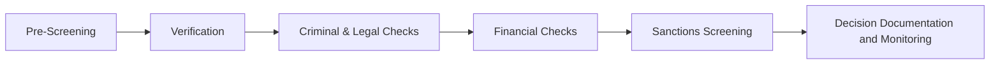

# Third-Party Due Diligence Workflow

## Overview

Corporate third-party due diligence is a structured process used to collect, verify, and evaluate information about a vendor, investor, contractor, supplier, or other third party before entering or maintaining a business relationship.

The process helps organizations identify legal, financial, operational, cybersecurity, regulatory, and reputational risks.

---

## Workflow Diagram

---

## Workflow Phases

### Phase 1 – Pre-Screening

Collect basic information about the entity and establish an initial risk profile.

**Typical information collected**

- Company name
- Registered address
- Contact information
- Corporate registration details
- Geographic location
- Industry sector
- Transaction value

---

### Phase 2 – Verification

Validate information provided by the entity and establish legitimacy.

**Typical information collected**

- Corporate registration records
- Beneficial ownership information
- Leadership information
- Organizational structure
- Business continuity documentation
- Identity and address information

---

### Phase 3 – Criminal & Legal Checks

Assess legal and criminal exposure associated with the entity.

**Typical information collected**

- Criminal records
- Litigation history
- Regulatory enforcement actions
- Government investigations
- Complaints and claims
- Tax liabilities

**Common sources**

- PACER
- State court records
- Regulatory databases

---

### Phase 4 – Financial Checks

Evaluate financial health and stability.

**Typical information collected**

- Audited financial statements
- Bankruptcy records
- Credit reports
- Financial liabilities
- Fraud indicators

---

### Phase 5 – Sanctions Screening

Identify prohibited or high-risk relationships.

**Typical information collected**

- OFAC screening results
- EU sanctions records
- UN sanctions records
- Politically Exposed Persons (PEP)
- Adverse media findings

---

### Phase 6 – Decision, Documentation & Monitoring

Make a risk-based decision and maintain continuous oversight.

**Typical activities**

- Risk scoring
- Approval or rejection
- Risk acceptance
- Documentation retention
- Ongoing monitoring
- Periodic reviews

---

## Explore Individual Workflow Stages

The full website will connect each workflow phase to:

- Data types collected
- Applicable laws and regulations
- Retention requirements
- Security controls
- Governance requirements
- Risks and mitigation measures
- Additional resources
