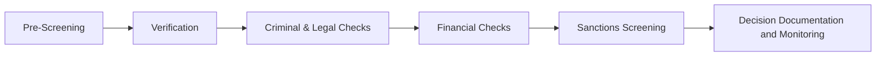

# Third-Party Due Diligence Workflow

## What is Due Diligence?

Corporate third-party due diligence is a structured process used to collect, verify, and evaluate information about a vendor, investor, contractor, supplier, or other third party before entering or maintaining a business relationship.

The process helps organizations identify, assess, and manage risks associated with third-party relationships and the data collected throughout the due diligence process.

---

## Typical Workflow

---

# Workflow Phases

## Phase 1 – Pre-Screening

### Purpose

Collecting basic information about the entity and establishing an initial risk profile.

### Data Categories
- Corporate Information
- Identity & Personal Information

### Applicable Laws
- GDPR Article 5
- GDPR Article 32
- Massachusetts General Laws Chapter 93H
- 201 CMR 17.00

### Privacy & Security Risks
- Excessive Data Collection
- Unauthorized Access
- Unauthorized Disclosure
- Inaccurate Records

### Governance Requirements
- Written Information Security Program (WISP)
- Vendor Management Program
- Third-Party Risk Assessment
- Data Classification Policy

### Cybersecurity Controls
- Access Control
- Encryption
- Audit Logging
- Data Classification & Labeling

---

## Phase 2 – Verification

### Purpose

Validating information provided by the entity and establishing legitimacy.

### Data Categories
- Corporate Information
- Identity & Personal Information
- Legal & Regulatory Information

### Applicable Laws
- Corporate Transparency Act (CTA)
- GDPR Article 5
- GDPR Article 6
- GDPR Article 32
- Massachusetts General Laws Chapter 93H
- 201 CMR 17.00

### Privacy & Security Risks
- Identity Theft
- Unauthorized Disclosure
- Unauthorized Access
- Excessive Data Collection
- Inaccurate Records

### Governance Requirements
- Lawful Basis Assessment
- Records of Processing Activities (ROPA)
- Vendor Risk Assessment
- Data Retention Schedule

### Cybersecurity Controls
- Authentication
- Access Control
- Encryption
- Audit Logging

---

## Phase 3 – Criminal & Legal Checks

### Purpose

Assessing criminal, legal, and regulatory exposure associated with the entity.

### Data Categories
- Criminal & Background Information
- Legal & Regulatory Information

### Applicable Laws
- GDPR Article 10
- GDPR Article 5
- GDPR Article 32
- Fair Credit Reporting Act (FCRA)
- Massachusetts General Laws Chapter 93H
- 201 CMR 17.00

### Privacy & Security Risks
- Unauthorized Disclosure
- Unauthorized Access
- Excessive Retention
- Automated Decision-Making
- Cross-Border Data Transfers
- Inaccurate Records

### Governance Requirements
- Data Protection Impact Assessment (DPIA)
- Lawful Basis Assessment
- Records of Processing Activities (ROPA)
- Human Review Procedure
- Data Retention Schedule

### Cybersecurity Controls
- Encryption
- Access Control
- Audit Logging
- Security Monitoring
- Data Loss Prevention (DLP)

---

## Phase 4 – Financial Checks

### Purpose

Evaluating financial health, stability, and financial risk.

### Data Categories
- Financial Information
- Corporate Information

### Applicable Laws
- Gramm-Leach-Bliley Act (GLBA)
- Fair Credit Reporting Act (FCRA)
- GDPR Article 5
- GDPR Article 32
- Massachusetts General Laws Chapter 93H
- 201 CMR 17.00

### Privacy & Security Risks
- Unauthorized Disclosure
- Unauthorized Access
- Data Breach
- Excessive Retention
- Inaccurate Financial Records

### Governance Requirements
- Data Retention Schedule
- Vendor Risk Assessment
- Records of Processing Activities (ROPA)
- Written Information Security Program (WISP)

### Cybersecurity Controls
- Encryption
- Access Control
- Audit Logging
- Security Monitoring

---

## Phase 5 – Sanctions Screening

### Purpose

Identifying prohibited, restricted, or high-risk relationships.

### Data Categories
- Sanctions & Watchlist Information
- Criminal & Background Information

### Applicable Laws
- OFAC Sanctions Programs
- Bank Secrecy Act (BSA)
- Anti-Money Laundering (AML) Requirements
- GDPR Article 5
- GDPR Article 32

### Privacy & Security Risks
- Unauthorized Disclosure
- Unauthorized Access
- Inaccurate Screening Results
- Cross-Border Data Transfers
- Excessive Retention

### Governance Requirements
- Continuous Monitoring Program
- Escalation Procedure
- Vendor Risk Assessment
- Data Retention Schedule

### Cybersecurity Controls
- Encryption
- Access Control
- Audit Logging
- Security Monitoring
- Third-Party Risk Management

---

## Phase 6 – Decision, Documentation & Monitoring

### Purpose

Making a risk-based decision, retaining supporting evidence, and maintaining continuous monitoring of third-party risk.

### Data Categories
- all collected due diligence information

### Applicable Laws
- GDPR Article 5
- GDPR Article 30
- GDPR Article 32
- Massachusetts General Laws Chapter 93H
- 201 CMR 17.00

### Privacy & Security Risks
- Excessive Retention
- Failure to Dispose of Data Securely
- Unauthorized Access
- Unauthorized Disclosure
- Incomplete Audit Trails

### Governance Requirements
- Written Information Security Program (WISP)
- Records of Processing Activities (ROPA)
- Data Retention Schedule
- Data Disposal Procedure
- Incident Response Plan
- Continuous Monitoring Program

### Cybersecurity Controls
- Audit Logging
- Security Monitoring
- Secure Data Disposal
- Access Control
- Encryption
- Data Loss Prevention (DLP)
