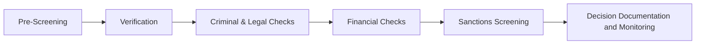

# Third-Party Due Diligence Workflow

## What is Due Diligence?

Corporate third-party due diligence is a structured process used to collect, verify, and evaluate information about a vendor, investor, contractor, supplier, or other third party before entering or maintaining a business relationship.

The process helps organizations identify legal, financial, operational, cybersecurity, regulatory, and reputational risks.

---

## Typical Workflow

---

# Workflow Phases

## Phase 1 – Pre-Screening

### Purpose

Collecting basic information about the entity and establishing an initial risk profile.

### Data Collected
- Company Name
- Registered Address
- Contact Information
- Corporate Registration Details
- Geographic Location
- Industry Sector
- Transaction Value

### Applicable Laws
- GDPR Article 5 – Data Minimization & Purpose Limitation
- GDPR Article 32 – Security of Processing
- Massachusetts General Laws Chapter 93H
- 201 CMR 17.00

### Privacy & Security Risks
- Unauthorized Access
- Unauthorized Disclosure
- Excessive Data Collection
- Inaccurate Records
- Third-Party Data Exposure

### Governance Requirements
- Third-Party Risk Assessment
- Vendor Management Program
- Data Classification Policy
- Written Information Security Program (WISP)

### Cybersecurity Controls
- Data Classification & Labeling
- Access Control
- Security Awareness Training
- Audit Logging
- Secure Data Transmission

---

## Phase 2 – Verification

### Purpose

Validate provided information and establish legitimacy of the entity.

### Data Collected
- Corporate Registration Records
- Beneficial Ownership Information
- Corporate Officers & Leadership Data
- Government-Issued Identification
- Physical Addresses
- Business Continuity Documentation
- Organizational Structure Information

### Applicable Laws
- Corporate Transparency Act (CTA)
- GDPR Article 5
- GDPR Article 6 – Lawful Basis for Processing
- GDPR Article 32
- Massachusetts General Laws Chapter 93H
- 201 CMR 17.00

### Privacy & Security Risks
- Identity Theft
- Unauthorized Access
- Excessive Data Collection
- Unauthorized Disclosure
- Insider Threats
- Inaccurate Records

### Governance Requirements
- Beneficial Ownership Verification Procedure
- Lawful Basis Assessment
- Records of Processing Activities (ROPA)
- Vendor Risk Assessment
- Data Retention Schedule

### Cybersecurity Controls
- Multi-Factor Authentication (MFA)
- Role-Based Access Control (RBAC)
- Encryption at Rest
- Encryption in Transit
- Audit Logging
- Identity Verification Controls

---

## Phase 3 – Criminal & Legal Checks

### Purpose

Assess legal, criminal, regulatory, and litigation exposure associated with the entity.

### Data Collected
- Criminal Records
- Litigation History
- Regulatory Enforcement Actions
- Government Investigations
- Complaints & Claims
- Tax Liabilities

### Applicable Laws
- GDPR Article 10 – Processing of Criminal Conviction Data
- GDPR Article 5
- GDPR Article 32
- Fair Credit Reporting Act (FCRA)
- Massachusetts General Laws Chapter 93H
- 201 CMR 17.00

### Privacy & Security Risks
- Unauthorized Disclosure
- Unauthorized Access
- Unauthorized Secondary Use
- Excessive Retention
- Inaccurate Background Information
- Automated Decision-Making Risks
- Cross-Border Data Transfer Risks

### Governance Requirements
- Data Protection Impact Assessment (DPIA)
- Lawful Basis Assessment
- Records of Processing Activities (ROPA)
- Data Retention Schedule
- Human Review Procedure
- Third-Party Risk Assessment

### Cybersecurity Controls
- Encryption at Rest
- Encryption in Transit
- Role-Based Access Control (RBAC)
- Multi-Factor Authentication (MFA)
- Audit Logging
- Data Loss Prevention (DLP)
- Security Monitoring

---

## Phase 4 – Financial Checks

### Purpose

Evaluate financial health, stability, and potential financial risk.

### Data Collected
- Audited Financial Statements
- Bankruptcy Records
- Credit Reports
- Financial Liabilities
- Fraud Indicators

### Applicable Laws
- Fair Credit Reporting Act (FCRA)
- GDPR Article 5
- GDPR Article 32
- Massachusetts General Laws Chapter 93H
- 201 CMR 17.00

### Privacy & Security Risks
- Unauthorized Disclosure
- Unauthorized Access
- Excessive Retention
- Third-Party Data Exposure
- Inaccurate Financial Records

### Governance Requirements
- Data Retention Schedule
- Vendor Risk Assessment
- Records of Processing Activities (ROPA)
- Third-Party Due Diligence Procedure

### Cybersecurity Controls
- Encryption at Rest
- Encryption in Transit
- Role-Based Access Control (RBAC)
- Audit Logging
- Data Integrity Controls
- Access Reviews

---

## Phase 5 – Sanctions Screening

### Purpose

Identify prohibited, restricted, or high-risk relationships.

### Data Collected
- OFAC Screening Results
- EU Sanctions Records
- UN Sanctions Records
- Politically Exposed Persons (PEP) Information
- Adverse Media Findings

### Applicable Laws
- Office of Foreign Assets Control (OFAC) Sanctions Programs
- Bank Secrecy Act (BSA)
- Anti-Money Laundering (AML) Requirements
- GDPR Article 5
- GDPR Article 32

### Privacy & Security Risks
- Unauthorized Disclosure
- Unauthorized Access
- Inaccurate Screening Results
- Excessive Retention
- Cross-Border Data Transfer Risks

### Governance Requirements
- Sanctions Screening Procedure
- Escalation Procedure
- Continuous Monitoring Program
- Vendor Risk Assessment
- Data Retention Schedule

### Cybersecurity Controls
- Encryption at Rest
- Encryption in Transit
- Role-Based Access Control (RBAC)
- Audit Logging
- Security Monitoring
- Third-Party Risk Management

---

## Phase 6 – Decision, Documentation & Monitoring

### Purpose

Make a risk-based decision, maintain supporting documentation, and continuously monitor third-party risk.

### Operations
- Risk Scoring
- Approval or Rejection
- Risk Acceptance
- Documentation Retention
- Ongoing Monitoring
- Periodic Reviews
- Re-Screening Activities

### Applicable Laws
- GDPR Article 5 – Storage Limitation
- GDPR Article 30 – Records of Processing Activities
- GDPR Article 32
- Massachusetts General Laws Chapter 93H
- 201 CMR 17.00

### Privacy & Security Risks
- Excessive Data Retention
- Failure to Dispose of Data Securely
- Unauthorized Access
- Unauthorized Disclosure
- Incomplete Audit Trails
- Inadequate Monitoring

### Governance Requirements
- Written Information Security Program (WISP)
- Data Retention Schedule
- Data Disposal Procedure
- Records of Processing Activities (ROPA)
- Continuous Monitoring Program
- Risk Acceptance Documentation
- Incident Response Plan

### Cybersecurity Controls
- Audit Logging
- Security Monitoring
- Secure Data Disposal
- Role-Based Access Control (RBAC)
- Encryption at Rest
- Data Loss Prevention (DLP)
